# Evidencias de la Unidad 2

Capturas tomadas el **04/11/2026** sobre el pipeline en ejecución (Open-Meteo → Kafka → Spark Structured Streaming → Pushgateway → Prometheus → Grafana). Cada bloque indica el criterio de la rúbrica que respalda.

## 1 y 2. Ingesta con Kafka (eventos empresariales y de sensor)

**Topics del pipeline en Kafka UI.** `atmos-aire` (12 845 mensajes, 2 MB), `atmos-clima` (12 779, 3 MB) y `atmos-negocio` (1 125, 220 KB), con 1 partición y factor de replicación 1. Los demás topics (`atmos-eventos`, `atmos-real`, `clima-real-eventos`) pertenecen a sesiones anteriores del curso.

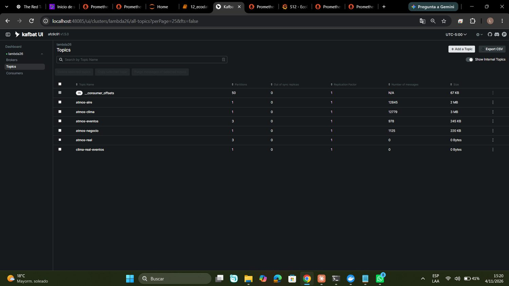

**Un mensaje abierto de `atmos-aire`.** Se ve la clave (`openmeteo-cams-juliaca`), el contrato JSON (`tipoEvento`, `sensorId`, `pm25`, `pm10`, `origen`, `timestamp`) y el tamaño real del evento (150 bytes). Esquema versionado en [Contrato de eventos](contrato-eventos.md).

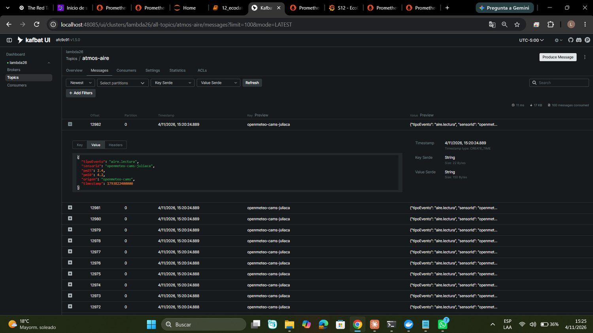

**Publicación y conteo desde Jupyter.** El notebook publica desde la API de Open-Meteo y cuenta los eventos por topic. *(Captura tomada antes de la segunda publicación; los totales exactos son los de Kafka UI.)*

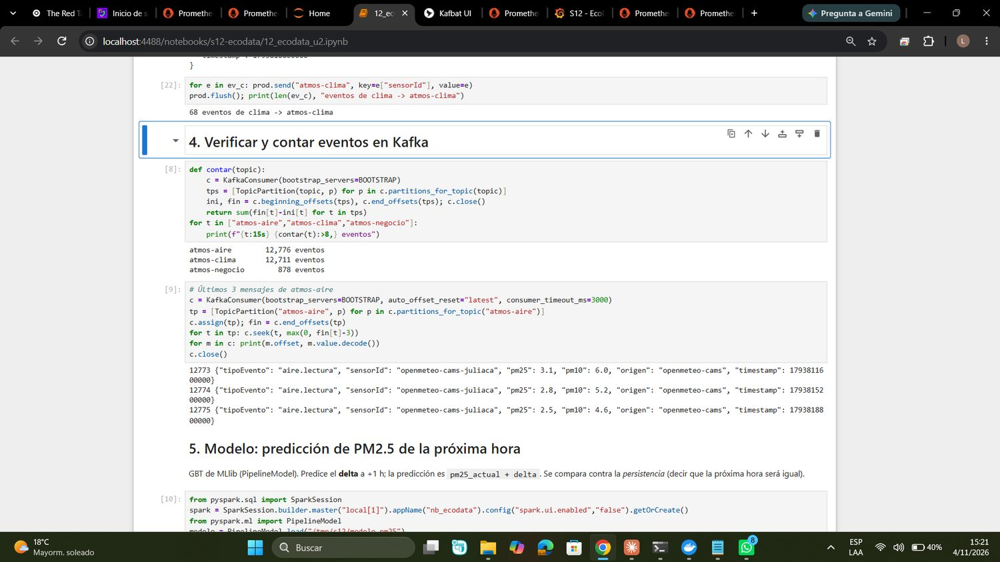

## 3. Streaming con Spark

**Jobs de streaming lanzados desde el notebook.** Un job por dimensión (aire y clima), ambos en ejecución, con su registro de arranque.

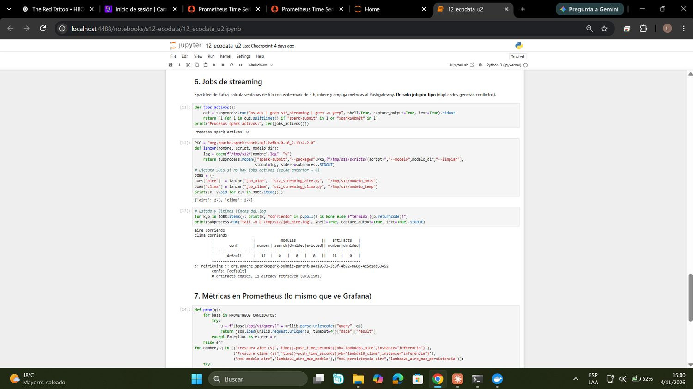

**Watermark en acción.** Al reenviar las últimas 48 h de la API, las horas más antiguas llegan fuera del watermark de 2 h y Spark las descarta y las cuenta: el panel «Filas descartadas por watermark» pasa de 0 a 20 y se dispara la alerta informativa `DescartesPorWatermarkCreciendo`.

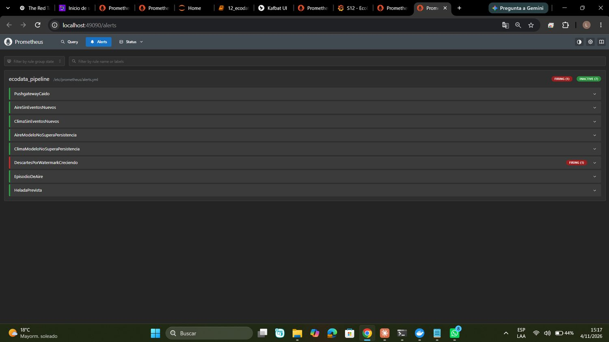

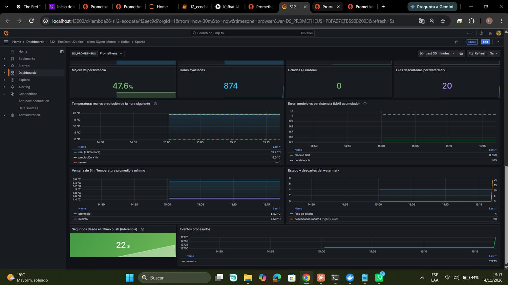

## 4. Observabilidad

**Prometheus: targets.** `pushgateway`, `kafka-exporter` y `prometheus` en estado UP.

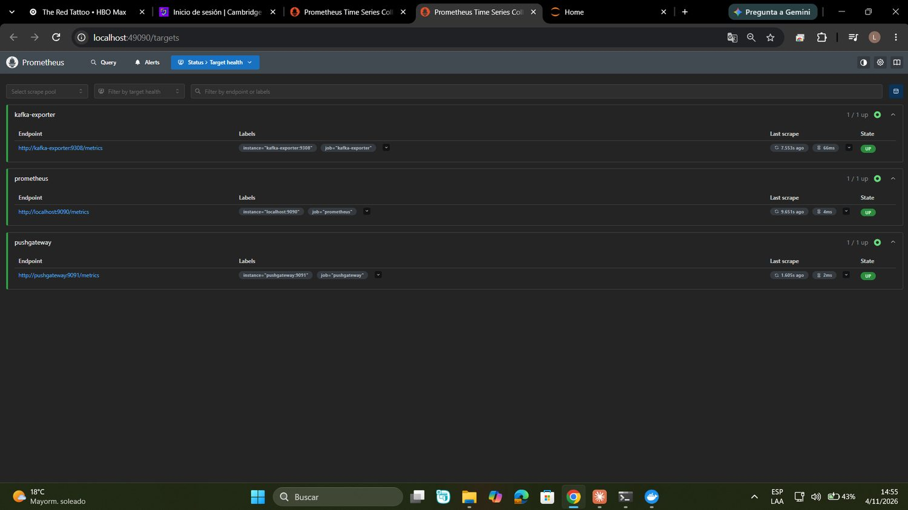

**Reglas de alerta cargadas.** Las ocho reglas del grupo `ecodata_pipeline`. Las dos de frescura usan `absent()` para disparar también si el job nunca empujó métricas. Archivo: `s12/operacion/prometheus/alerts.yml`.

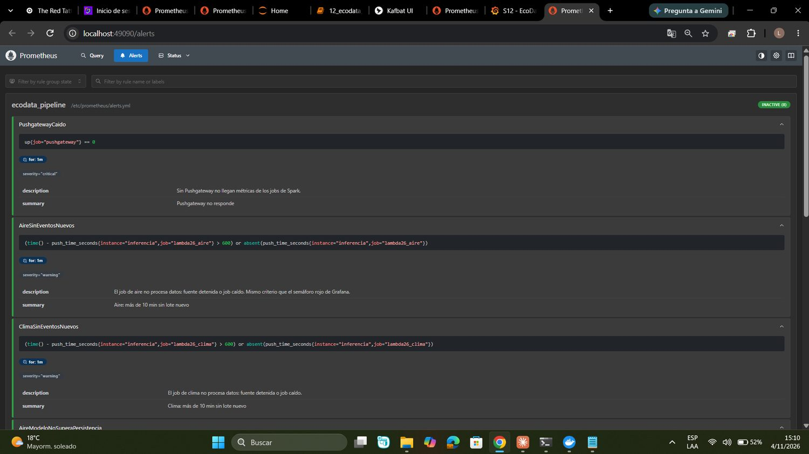

**Correlación: la fuente se detiene → frescura → alerta.** Al dejar de llegar datos, «Segundos desde el último push» superó los 600 s (14 min) y el semáforo pasó a rojo.

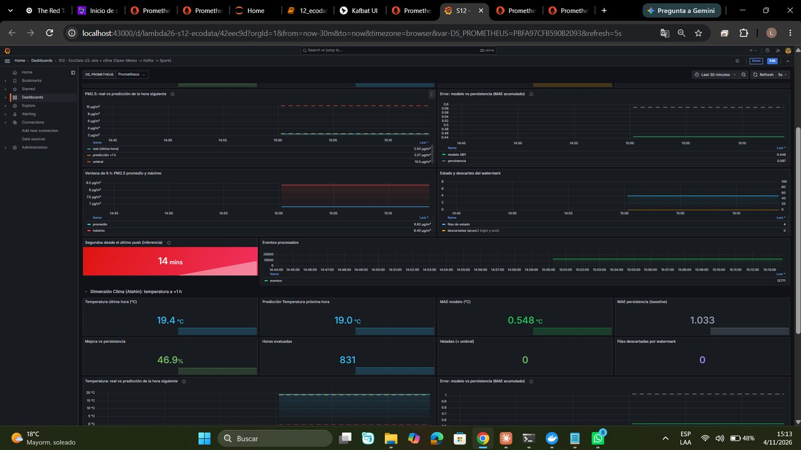

Las alertas `AireSinEventosNuevos` y `ClimaSinEventosNuevos` pasaron a *Firing*.

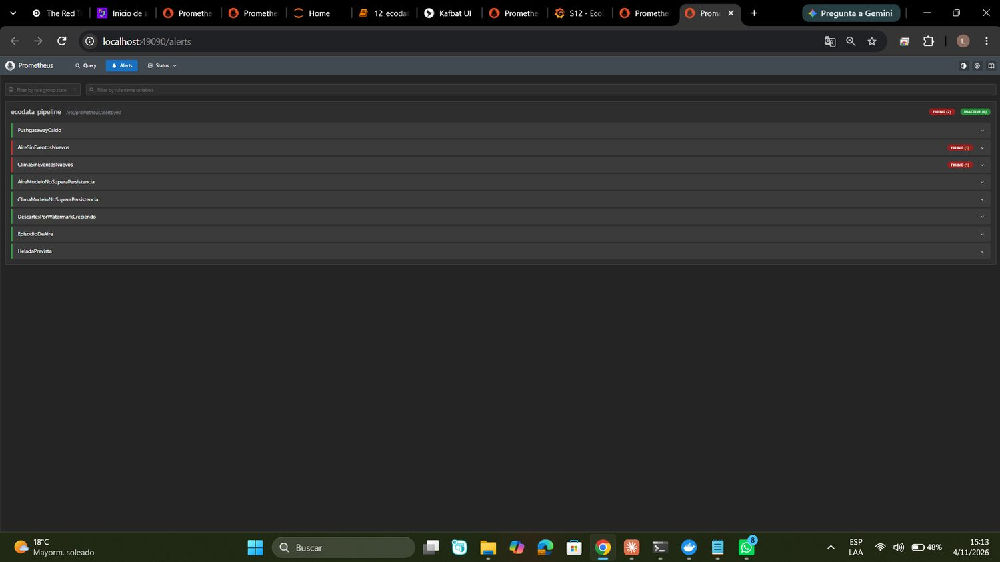

**Recuperación.** Al publicar de nuevo, la frescura bajó a 27 s, el semáforo volvió a verde y las alertas se resolvieron.

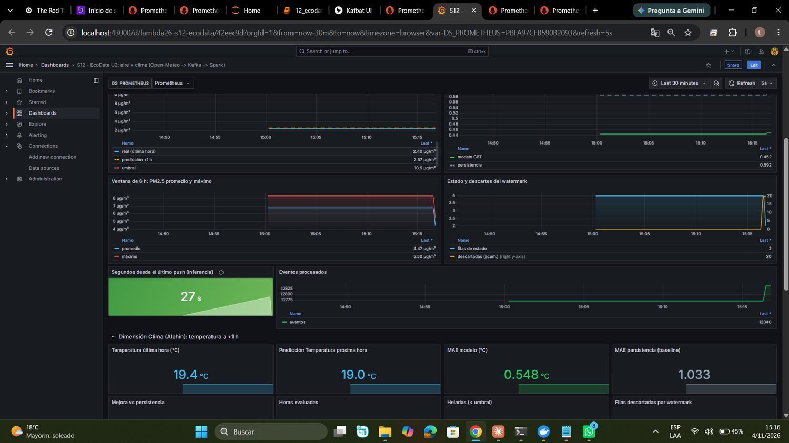

## 5. Costos y escalado

Volúmenes medidos, tarifas de referencia y ruta de crecimiento en [Operación, escalado y costos](operacion.md).

## 6 y 7. Salidas BI/ML e inferencia validada

**Predicción de PM2.5 a +1 h.** Con 2,50 µg/m³ a las 19:00 UTC, el modelo GBT predice un delta de +0,07 y 2,57 µg/m³ para la hora siguiente, lejos del umbral de episodio (10,5 µg/m³, el p95 del entrenamiento).

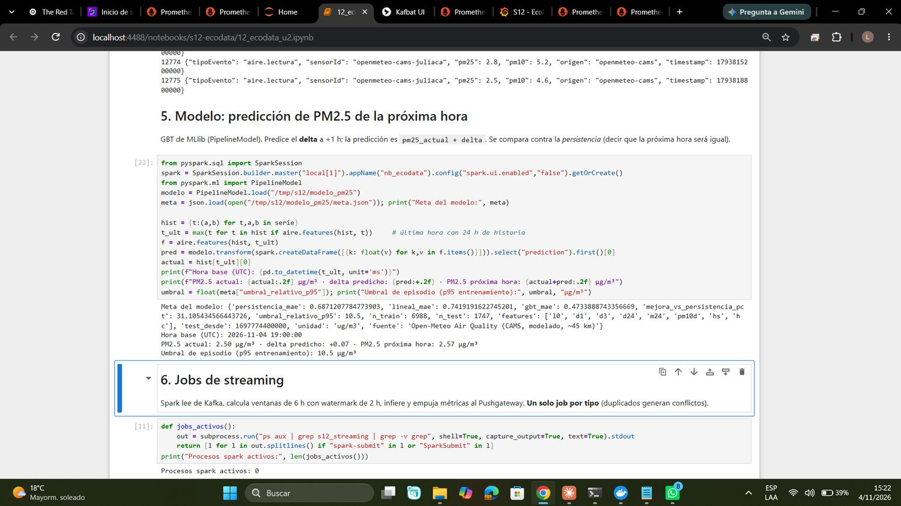

**Métricas leídas de Prometheus y del Pushgateway.** Modelo frente a persistencia en aire (MAE 0,446 frente a 0,587, mejora de 24,1 %) y clima (MAE 0,548 frente a 1,033, mejora de 46,9 %).

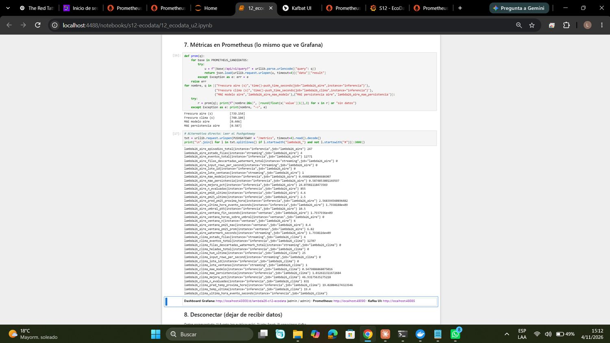

**Dashboard de Grafana, sección de clima.** Temperatura real y predicción a +1 h, MAE del modelo frente a la persistencia y mejora acumulada.

## Nota sobre las cifras
Los contadores acumulados (eventos procesados, horas evaluadas, filas descartadas) incluyen los replays de la demostración, por lo que no equivalen a horas distintas de datos reales. Las métricas de error (MAE) son las comparables.
